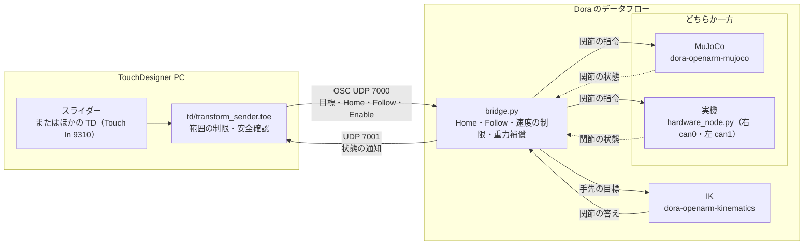

openarm-controller-touchdesigner
===

[](https://www.python.org/)
[](https://derivative.ca/)
[](LICENSE)

TouchDesigner から OSC で OpenArm v2（Pedestal）の両腕を動かすための、Dora のデータフローと TouchDesigner の送信用プロジェクトです。

- MuJoCo のシミュレーションと実機で、同じ TouchDesigner のプロジェクト・同じ OSC の形式を使います。
- 手先の目標（Home からの相対の位置と回転、グリッパー）を TouchDesigner から送ると、bridge が IK を通して関節の指令にし、MuJoCo か実機へ送ります。

# Table Of Contents

<details>
<summary>Details</summary>

- [Environment](#environment)
- [Installation](#installation)
  - [Python の環境](#python-の環境)
  - [TouchDesigner](#touchdesigner)
  - [実機](#実機)
- [Usage](#usage)
  - [MuJoCo で動かす](#mujoco-で動かす)
  - [実機で動かす](#実機で動かす)
- [Description](#description)
  - [構成](#構成)
  - [送る値](#送る値)
  - [安全について](#安全について)
  - [テスト](#テスト)
  - [Documentation](#documentation)
- [References](#references)
- [Troubleshooting](#troubleshooting)
- [Versions](#versions)
- [Author](#author)
- [License](#license)

</details>

# Environment

- Windows 11（TouchDesigner、MuJoCo）
- Ubuntu（実機）
- TouchDesigner 2025.33230
- Python 3.11（[uv](https://docs.astral.sh/uv/) で用意）
- OpenArm v2 Pedestal、CAN-FD のアダプター 2 つ（右腕・左腕。実機で動かすときだけ）

# Installation

## Python の環境

1. [uv](https://docs.astral.sh/uv/) を入れます。
2. リポジトリを clone し、ルートで環境を作ります。

   ```bash
   uv sync --extra sim
   ```

   - 仮想環境はルートの `.venv` に作られ、TouchDesigner の Python とは独立しています。
   - 依存のバージョンは `uv.lock` で固定しています。

## TouchDesigner

TouchDesigner 2025.33230 で `td/transform_sender.toe` を開きます。外部の Python のモジュールは使いません。

## 実機

実機の準備（CAN、ネットワーク、設定）は [docs/hardware.md](docs/hardware.md) を読んでから行ってください。Ubuntu PC では、実機のドライバーも入れます。

```bash
uv sync --extra sim --extra hardware
```

# Usage

## MuJoCo で動かす

1. MuJoCo を起動します（Windows の PowerShell）

   ```powershell
   .\run-mujoco.cmd
   ```

   - Linux・macOS は `bash run-mujoco.sh` です
   - ログに `[OSC] 127.0.0.1:7000 backend=sim` が出たら準備ができています
2. TouchDesigner で `td/transform_sender.toe` を開き、送り先を **MuJoCo**（127.0.0.1）にします
3. 入力の切り替え（Input source）を **Slider** にします
4. **Move HOME** を押し、ログに左右の `HOME complete -> READY` が出るまで待ちます
5. **Enable sending data** を ON にします。スライダーを動かすと、腕がついてきます
6. 終了は、起動した端末で `Ctrl+C` を押します

詳しくは [docs/mujoco.md](docs/mujoco.md) と [docs/td-sender.md](docs/td-sender.md) を見てください。

## 実機で動かす

[docs/hardware.md](docs/hardware.md) の準備の後、Ubuntu PC で起動します。

```bash
bash run-hardware.sh
```

- TouchDesigner の送り先を **Real robot** にし、使う腕の Enable → Move HOME → Enable sending data の順に操作します。
- `--record` を付けると、Follow の間の記録を書き出します。

# Description

## 構成



| ファイル | 役割 |
|---|---|
| `bridge.py` | OSC の受信、Home・Follow の状態の管理、速度の制限、重力補償、状態の通知、記録 |
| `hardware_node.py` | 実機の片腕のドライバーを動かす Dora のノード（Enable 時の開始動作、通常停止） |
| `status_monitor.py` | 状態の通知を表示する端末用のモニター（TouchDesigner の代わりに使う場合） |
| `config/control.yml` | bridge の設定（ポート、速度の上限、Home の姿勢、通知の宛先、記録の場所） |
| `config/openarm_pedestal.yaml` | 実機のドライバーの設定（関節の範囲、ゲイン、CAN） |
| `dataflow-mujoco.yml`・`dataflow-hardware.yml` | Dora のデータフロー |
| `run-mujoco.cmd`・`run-mujoco.sh`・`run-hardware.sh` | 起動用のスクリプト |
| `td/transform_sender.toe` | TouchDesigner の送信用プロジェクト（スライダーと外部からの入力、安全確認、送信） |

## 送る値

- 腕ごとに `[px, py, pz, qw, qx, qy, qz, gripper]` を送ります。
- 位置と回転は、Home の手先からの相対です。座標はモデルの `arm_origin`（x 前・y 左・z 上）です。
- アドレスと値の形、ほかの TouchDesigner のプロジェクトから sender へ送る形は [docs/osc-protocol.md](docs/osc-protocol.md) を見てください。

## 安全について

- **非常時は、実機の非常停止を使ってください。** ソフトウェアの停止は、非常停止の代わりになりません。
- 支柱やもう一方の腕との衝突は、TouchDesigner・bridge・IK のどこでも防いでいません。操作する人が見て避けてください。
- bridge は、手先の目標の位置（Home からの相対）の大きさが 0.30 m（`config/control.yml` の `max_move_m`）を超えた値を捨てます。値が 0.2 秒届かないと、その腕を止めます。作業範囲の制限は TouchDesigner 側（sender）で行います。
- 実機の速度の上限は、手先 0.2 m/s・関節 0.75 rad/s・グリッパー 2.0 rad/s です（`config/control.yml`）。これは動作確認に使っている値で、安全を保証する値ではありません。

## テスト

```bash
uv run --extra sim pytest -q
```

- 実機は使いません。
- Dora のプロセスを実際に起動するテストは、環境変数 `OPENARM_RUN_DATAFLOW_TESTS=1` のときだけ動きます（[docs/mujoco.md](docs/mujoco.md)）。

## Documentation

- [docs/mujoco.md](docs/mujoco.md)：MuJoCo の起動の方法、Home の姿勢、物理計算の有無、テスト
- [docs/hardware.md](docs/hardware.md)：実機の準備、起動、操作、止め方、状態の見方、記録
- [docs/td-sender.md](docs/td-sender.md)：TouchDesigner の送信用プロジェクトの使い方と安全確認
- [docs/osc-protocol.md](docs/osc-protocol.md)：OSC のアドレスと値の形、外部から sender へ送る形、状態の通知

# References

- [OpenArm MuJoCo 2.3.0](https://github.com/enactic/openarm_mujoco/tree/2.3.0)
- [Dora MuJoCo 0.5.1](https://github.com/enactic/dora-openarm-mujoco/tree/0.5.1)
- [Dora IK 0.2.3](https://github.com/enactic/dora-openarm-kinematics/tree/0.2.3)
- [OpenArm Control 0.5.0](https://github.com/enactic/openarm_control/tree/0.5.0)
- [Dora OpenArm（実機のノード）1.3.0](https://github.com/enactic/dora-openarm)
- [OpenArm CAN CLI](https://docs.openarm.dev/api-reference/can/cli/)

# Troubleshooting

## Enable sending data を ON にしても動かない

- Move HOME の後、ログに `HOME complete -> READY` が出てから ON にしたか確かめてください
- sender の Input source と、腕の Enable の状態を確かめてください（[docs/td-sender.md](docs/td-sender.md)）

## ログに Rejected が出続ける

- 送っている値の形を確かめてください（[docs/osc-protocol.md](docs/osc-protocol.md)）
- 位置の大きさが 0.30 m を超えていないか確かめてください

## 状態の表が更新されない

- Dora が動いているか確かめてください
- 実機では、`config/control.yml` の `status.host` と、TouchDesigner の PC のファイアウォール（UDP 7001）を確かめてください

ほかは [docs/hardware.md](docs/hardware.md) の「うまくいかないとき」を見てください。

# Versions

- 1.0.0: 初期公開版

# Author

- Takayoshi Hagiwara (NITech)

# License

- [Apache License 2.0](LICENSE)
- `config/openarm_pedestal.yaml` は Enactic, Inc. のファイルを基にしたもので、同じライセンスです
