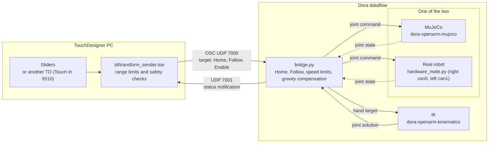

openarm-controller-touchdesigner
===

[](https://www.python.org/)
[](https://derivative.ca/)
[](LICENSE)

A Dora dataflow and a TouchDesigner sender project for moving both arms of OpenArm v2 (Pedestal) from TouchDesigner over OSC.

- The MuJoCo simulation and the real robot use the same TouchDesigner project and the same OSC format.
- When TouchDesigner sends a hand target (position and rotation relative to Home, and the gripper), the bridge converts it into joint commands through IK and sends them to MuJoCo or the real robot.

# Table Of Contents

<details>
<summary>Details</summary>

- [Environment](#environment)
- [Installation](#installation)
  - [Python environment](#python-environment)
  - [TouchDesigner](#touchdesigner)
  - [Real robot](#real-robot)
- [Usage](#usage)
  - [Run with MuJoCo](#run-with-mujoco)
  - [Run with the real robot](#run-with-the-real-robot)
- [Description](#description)
  - [Architecture](#architecture)
  - [Values to send](#values-to-send)
  - [Safety](#safety)
  - [Tests](#tests)
  - [Documentation](#documentation)
- [References](#references)
- [Troubleshooting](#troubleshooting)
- [Versions](#versions)
- [Author](#author)
- [License](#license)

</details>

# Environment

- Windows 11 (TouchDesigner, MuJoCo)
- Ubuntu (real robot)
- TouchDesigner 2025.33230
- Python 3.11 (provided by [uv](https://docs.astral.sh/uv/))
- OpenArm v2 Pedestal and two CAN-FD adapters (right arm and left arm; only for the real robot)

# Installation

## Python environment

1. Install [uv](https://docs.astral.sh/uv/).
2. Clone the repository and create the environment at the root.

   ```bash
   uv sync --extra sim
   ```

   - The virtual environment is created in `.venv` at the root and is independent of TouchDesigner's Python.
   - Dependency versions are pinned in `uv.lock`.

## TouchDesigner

Open `td/transform_sender.toe` with TouchDesigner 2025.33230. No external Python modules are used.

## Real robot

Read [docs/hardware_en.md](docs/hardware_en.md) before preparing the real robot (CAN, network, settings). On the Ubuntu PC, also install the real robot driver.

```bash
uv sync --extra sim --extra hardware
```

# Usage

## Run with MuJoCo

1. Start MuJoCo (Windows PowerShell)

   ```powershell
   .\run-mujoco.cmd
   ```

   - On Linux and macOS, use `bash run-mujoco.sh`
   - It is ready when `[OSC] 127.0.0.1:7000 backend=sim` appears in the log
2. Open `td/transform_sender.toe` in TouchDesigner and set the destination to **MuJoCo** (127.0.0.1)
3. Set the input switch (Input source) to **Slider**
4. Press **Move HOME** and wait until `HOME complete -> READY` appears in the log for both arms
5. Turn **Enable sending data** ON. When you move the sliders, the arms follow
6. To quit, press `Ctrl+C` in the terminal where you started it

For details, see [docs/mujoco_en.md](docs/mujoco_en.md) and [docs/td-sender_en.md](docs/td-sender_en.md).

## Run with the real robot

After the preparation in [docs/hardware_en.md](docs/hardware_en.md), start it on the Ubuntu PC.

```bash
bash run-hardware.sh
```

- Set the TouchDesigner destination to **Real robot**, then operate in this order: Enable for the arm you use → Move HOME → Enable sending data.
- With `--record`, the data during Follow is written out.

# Description

## Architecture



| File | Role |
|---|---|
| `bridge.py` | OSC reception, Home and Follow state management, speed limits, gravity compensation, status notification, recording |
| `hardware_node.py` | Dora node that runs the driver for one arm of the real robot (start motion on Enable, normal stop) |
| `status_monitor.py` | Terminal monitor that displays status notifications (when used instead of TouchDesigner) |
| `config/control.yml` | bridge settings (ports, speed limits, Home pose, notification destination, recording location) |
| `config/openarm_pedestal.yaml` | Real robot driver settings (joint ranges, gains, CAN) |
| `dataflow-mujoco.yml`, `dataflow-hardware.yml` | Dora dataflows |
| `run-mujoco.cmd`, `run-mujoco.sh`, `run-hardware.sh` | Startup scripts |
| `td/transform_sender.toe` | TouchDesigner sender project (sliders and external input, safety checks, sending) |

## Values to send

- Send `[px, py, pz, qw, qx, qy, qz, gripper]` for each arm.
- Position and rotation are relative to the Home hand pose. The coordinates are the model's `arm_origin` (x forward, y left, z up).
- For the addresses and value formats, and the format for sending to the sender from another TouchDesigner project, see [docs/osc-protocol_en.md](docs/osc-protocol_en.md).

## Safety

- **In an emergency, use the real robot's emergency stop.** A software stop is not a substitute for the emergency stop.
- Collisions with the pillar or the other arm are not prevented anywhere in TouchDesigner, the bridge, or IK. The operator must watch and avoid them.
- The bridge discards values whose hand target position (relative to Home) has a magnitude over 0.30 m (`max_move_m` in `config/control.yml`). If no value arrives for 0.2 s, it stops that arm. The workspace limits are applied on the TouchDesigner side (sender).
- The real robot speed limits are 0.2 m/s for the hand, 0.75 rad/s for the joints, and 2.0 rad/s for the gripper (`config/control.yml`). These are the values used for operation checks and do not guarantee safety.

## Tests

```bash
uv run --extra sim pytest -q
```

- The real robot is not used.
- Tests that actually start Dora processes run only when the environment variable `OPENARM_RUN_DATAFLOW_TESTS=1` is set ([docs/mujoco_en.md](docs/mujoco_en.md)).

## Documentation

- [docs/mujoco_en.md](docs/mujoco_en.md): how to start MuJoCo, Home poses, with or without physics, tests
- [docs/hardware_en.md](docs/hardware_en.md): real robot preparation, startup, operation, stopping, reading the status, recording
- [docs/td-sender_en.md](docs/td-sender_en.md): how to use the TouchDesigner sender project and its safety checks
- [docs/osc-protocol_en.md](docs/osc-protocol_en.md): OSC addresses and value formats, the format for sending to the sender from outside, status notification

# References

- [OpenArm MuJoCo 2.3.0](https://github.com/enactic/openarm_mujoco/tree/2.3.0)
- [Dora MuJoCo 0.5.1](https://github.com/enactic/dora-openarm-mujoco/tree/0.5.1)
- [Dora IK 0.2.3](https://github.com/enactic/dora-openarm-kinematics/tree/0.2.3)
- [OpenArm Control 0.5.0](https://github.com/enactic/openarm_control/tree/0.5.0)
- [Dora OpenArm (real robot node) 1.3.0](https://github.com/enactic/dora-openarm)
- [OpenArm CAN CLI](https://docs.openarm.dev/api-reference/can/cli/)

# Troubleshooting

## Nothing moves after turning Enable sending data ON

- Check that you turned it ON after `HOME complete -> READY` appeared in the log following Move HOME
- Check the sender's Input source and the Enable state of the arm ([docs/td-sender_en.md](docs/td-sender_en.md))

## Rejected keeps appearing in the log

- Check the format of the values you are sending ([docs/osc-protocol_en.md](docs/osc-protocol_en.md))
- Check that the position magnitude does not exceed 0.30 m

## The status table is not updated

- Check that Dora is running
- On the real robot, check `status.host` in `config/control.yml` and the firewall (UDP 7001) on the TouchDesigner PC

For other cases, see the troubleshooting section of [docs/hardware_en.md](docs/hardware_en.md).

# Versions

- 1.0.0: Initial release

# Author

- Takayoshi Hagiwara (NITech)

# License

- [Apache License 2.0](LICENSE)
- `config/openarm_pedestal.yaml` is based on a file by Enactic, Inc. and is under the same license
