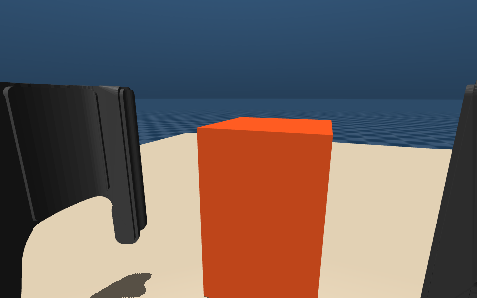
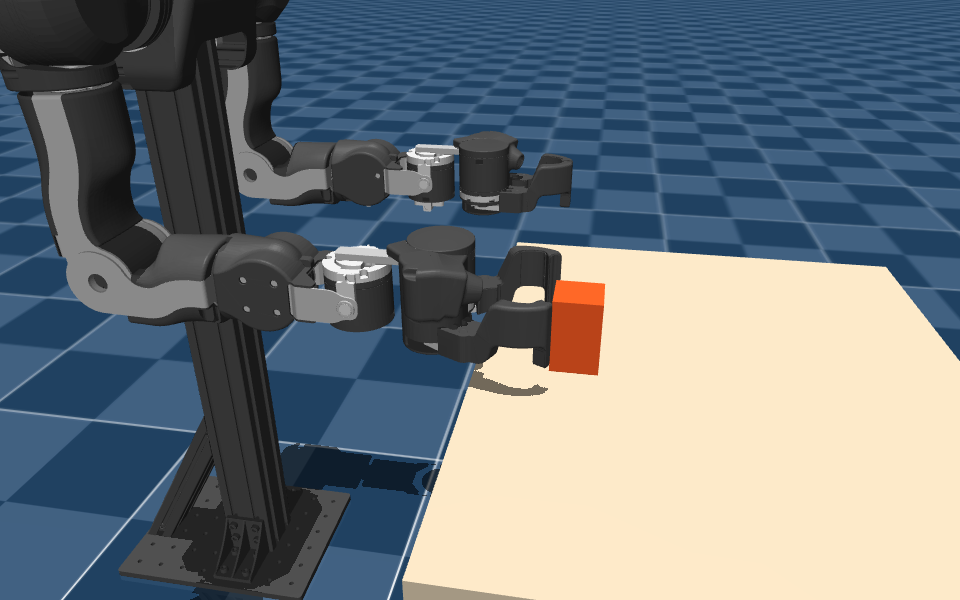
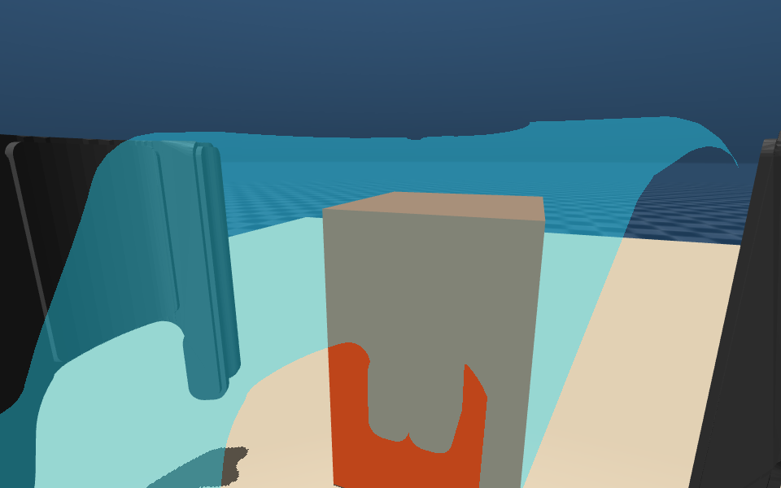

# OpenArm 把持判断ベンチマーク 検証レポート

2026年11月24日作成．モデル比較の主な計測は2026年11月23日（JST）．

## 要点

- 現在の手首姿勢で閉指すべきかを，MuJoCoの閉指・持ち上げ・保持試験で採点した．初期の80例では，Luna Decisionsが全件 `wait`，Qwen2.5-VL 3Bが全件 `close` だった．
- 同じ箱配置の6姿勢では，ネイティブ三択に加え，生成型3経路の出力を共通JSON Schemaに揃えた．元の手首画像1枚で，Luna Responsesは両方の出力形式で全件 `wait` だった．
- 同じ6姿勢への空閉じ重畳は，Luna Responsesで正しい閉指3/3，誤閉指0/3だった．応答中央値は1.42秒，p95は1.72秒で，500 ms以内の正しい閉指は0/3だった．メイン＋手首の2枚では，Terraの誤閉指が元画像の2/3から0/3になり，正しい閉指は2/3だった．
- 各条件の小規模観測である．6姿勢は一つの箱配置から作成したため，物体・配置・実機への一般化や実時間制御の適合性には追加の測定が必要になる．

## 評価方法

- OpenArm v2 Pedestalモデルを用いた．主な環境はMuJoCo 3.17.0，`openarm-mujoco` 2.3.0，`openarm-control` 0.5.0．対象は40 × 40 × 64 mm，60 gの箱一つ．右手首のカメラ `camera_wrist_right` でRGB画像を取得した．
- 保存した状態を復元し，腕の姿勢を維持しながら0.35秒で閉指して0.15秒待った後，0.40秒かけて40 mm持ち上げ，0.40秒保持した．接触，支持面からの離脱，保持中の安定を使って成否を決めた．初期状態やロボットの追従に異常がある例は無効とした．
- モデルは画像と質問から `close`（閉指する），`wait`（待つ），`uncertain`（保留する）の一つを返す．モデルへの入力と，評価用のMuJoCo状態・正解ラベルは分けた．正しい閉指の母数は把持可能例，誤閉指の母数は把持不可能例．保留は有効回答として別に数えた．
- 応答レイテンシは画像をリクエストに詰める処理から，判定を受け取り検証するまでの時間．HTTP経路では通信を含む．d3-liteはローカルの同一プロセスで計測した．画像生成，モデル起動，採点は計測区間の外にある．表の分位点は有効回答から求め，500 ms以内の正しい閉指は全把持可能例を母数とした．同じ結果データに100 ms・200 msの件数も保存している．

[評価コードと再現手順](../README.md) · [判定データと出典ハッシュ](results.json)

## 初期データ生成と80例のパイロット

seed 42で480 × 300の4例（成功2，失敗2）と，960 × 600の8例（成功4，失敗4）を生成した．seed 113のパイロットは50配置・100例（成功50，失敗50）で，用途別の分割は配置単位とした．devは10配置・20例，evalは40配置・80例．devの2例で疎通を確認し，evalの80例でルートごとに1回計測した．80例の集計は各経路のウォームアップ1回を除いた値である．このパイロットのp95は順位法による原集計を掲載し，後続の6例は線形補間を用いた．

| 評価条件 | 有効回答 | 正しい閉指 | 誤閉指 | 保留件数 | 500 ms以内の正しい閉指 | p50（ms） | p95（ms） |
| --- | ---: | ---: | ---: | ---: | ---: | ---: | ---: |
| Luna Decisions | 80/80 | 0/40 | 0/40 | 0 | 0/40 | 300.6 | 629.8 |
| Qwen2.5-VL 3B（初期ローカル経路） | 80/80 | 40/40 | 40/40 | 0 | 0/40 | 2381.8 | 4428.5 |

## 6姿勢の設計ケースと元画像の比較

箱の配置を固定し，基準手先姿勢からの並進オフセットを指定した．画像は960 × 600．MuJoCo試験の成否と設計時の想定は6例すべてで一致した．

| ケース | 基準からの手先オフセット X, Y, Z（mm） | 把持試験 |
| --- | --- | --- |
| 中央（`centered`） | 0, 0, 0 | 成功 |
| 手前の到達境界（`near_reach`） | −25, 0, 0 | 成功 |
| 高めの到達境界（`raised_reachable`） | 0, 0, +29 | 成功 |
| 届かない手前（`too_short`） | −39, 0, 0 | 失敗 |
| 高すぎる（`too_high`） | 0, 0, +48 | 失敗 |
| 到達境界から横にずれた姿勢（`short_lateral`） | −25, +16, 0 | 失敗 |

Luna Decisionsとd3-liteはネイティブ三択を使った．生成型はLuna Responses，Terra（Chat Completions），Qwen3-VL 4B Instruct 4-bit（vLLM-Metal／MLX）を計測した．最初は1語で回答させ，次に三経路で同じJSON Schemaを使用した．JSON Schema条件は出力上限を32トークンに揃えた．Luna ResponsesとTerraは reasoning effort を `none` に設定した．d3-liteはリビジョン `6c01fba` の公式ランタイムをApple M3 Max GPU（MPS，BF16）で実行した．vLLM macOS CPU版での起動試行は `causal_conv1d_weight_pack` を解決できず，記録したレイテンシはMPSの値である．

| 評価条件 | 有効回答 | 正しい閉指 | 誤閉指 | 保留件数 | 500 ms以内の正しい閉指 | p50（ms） | p95（ms） |
| --- | ---: | ---: | ---: | ---: | ---: | ---: | ---: |
| Luna Decisions・ネイティブ三択 | 6/6 | 0/3 | 0/3 | 0 | 0/3 | 606.2 | 2446.5 |
| d3-lite・ネイティブ三択 | 6/6 | 3/3 | 3/3 | 0 | 2/3 | 223.4 | 1907.1 |
| Luna Responses・1語 | 6/6 | 0/3 | 0/3 | 0 | 0/3 | 1342.9 | 1676.2 |
| Luna Responses・JSON Schema | 6/6 | 0/3 | 0/3 | 0 | 0/3 | 1401.9 | 2796.2 |
| Terra・1語 | 6/6 | 2/3 | 2/3 | 0 | 0/3 | 2699.8 | 4178.9 |
| Terra・JSON Schema | 6/6 | 2/3 | 2/3 | 0 | 0/3 | 2449.9 | 4126.2 |
| Qwen3-VL・1語 | 6/6 | 2/3 | 1/3 | 2 | 0/3 | 731.2 | 4448.3 |
| Qwen3-VL・JSON Schema | 6/6 | 1/3 | 0/3 | 5 | 0/3 | 822.8 | 3298.7 |

Qwen3-VLでは，JSON Schema条件で誤閉指が1件から0件に減り，正しい閉指は2件から1件，保留は2件から5件に変わった．TerraとLuna Responsesの判定は各6例で一致した．プロンプトの回答形式と出力上限をまとめて変えた一回ずつの計測なので，差をスキーマ制約だけに帰属するには追加比較が必要になる．

## メイン＋手首の2枚と空閉じ重畳の比較

既存6姿勢の保存状態を使った．再描画した元の手首PNGと正解ラベルは既存版とバイト単位で一致した．モデルには各条件で画像の意味を説明し，同じ把持の問いと三つの選択肢を渡した．

- **メイン＋手首の2枚**（`main-wrist`）は，固定した斜め視点のメイン画像，元の手首画像の順で送った．MuJoCoのアセットにメイン視点が定義されていなかったため，評価用の固定視点を追加した．
- **空閉じ重畳の1枚**（`wrist-overlay`）は，手首の姿勢を固定し，左右の指を空中で閉じ切った想定姿勢（0 rad）に置いた．指の投影領域だけをシアン，不透明度40%で元画像に重ねた．重畳の計算には手首と指の形状を使い，箱の位置と把持の成否は引き続き採点に使った．

下図は `near_reach` の同一状態．

| 元の手首画像 | メイン画像 | 空閉じ重畳 |
| --- | --- | --- |
|  |  |  |

各欄は正しい閉指／誤閉指の件数．把持可能・不可能はそれぞれ3例．

| モデル | 元画像1枚 | メイン＋手首の2枚 | 空閉じ重畳の1枚 |
| --- | ---: | ---: | ---: |
| Luna Responses | 0／0 | 0／0 | 3／0 |
| Terra | 2／2 | 2／0 | 3／2 |
| Qwen3-VL | 1／0 | 1／1 | 3／2 |
| d3-lite | 3／3 | 3／3 | 0／0 |
| Luna Decisions | 0／0 | 0／0 | 0／0 |

### 新しい入力条件のレイテンシと保留

| 評価条件 | 有効回答 | 正しい閉指 | 誤閉指 | 保留件数 | 500 ms以内の正しい閉指 | p50（ms） | p95（ms） |
| --- | ---: | ---: | ---: | ---: | ---: | ---: | ---: |
| Luna Responses・2枚 | 6/6 | 0/3 | 0/3 | 0 | 0/3 | 1467.4 | 1877.3 |
| Luna Responses・重畳 | 6/6 | 3/3 | 0/3 | 0 | 0/3 | 1416.4 | 1721.7 |
| Terra・2枚 | 6/6 | 2/3 | 0/3 | 0 | 0/3 | 4058.2 | 6035.9 |
| Terra・重畳 | 6/6 | 3/3 | 2/3 | 0 | 0/3 | 2710.1 | 5286.1 |
| Qwen3-VL・2枚 | 6/6 | 1/3 | 1/3 | 1 | 0/3 | 1414.8 | 3566.0 |
| Qwen3-VL・重畳 | 6/6 | 3/3 | 2/3 | 1 | 0/3 | 761.6 | 832.9 |
| d3-lite・2枚 | 6/6 | 3/3 | 3/3 | 0 | 2/3 | 411.2 | 781.2 |
| d3-lite・重畳 | 6/6 | 0/3 | 0/3 | 0 | 0/3 | 237.8 | 297.6 |
| Luna Decisions・2枚 | 6/6 | 0/3 | 0/3 | 0 | 0/3 | 1992.2 | 5681.3 |
| Luna Decisions・重畳 | 6/6 | 0/3 | 0/3 | 0 | 0/3 | 1106.6 | 4146.5 |

Terraの重畳条件の初回は有効3/6（タイムアウト1件，名前解決エラー2件）だった．表には同じ設定で6例すべてを再計測した結果を掲載した．初回の各試行も結果データに保存している．

重畳への反応は経路で異なった．Luna Responsesでは把持可能と不可能をすべて区別した．Qwen3-VLとTerraは重畳で正しい閉指が増え，誤閉指は各2件だった．d3-liteは2枚条件で全件 `close`，重畳条件で全件 `wait`．前者は正例2件に500 ms以内で `close` を返し，負例3件にも `close` を返した．Luna Decisionsは全画像条件で全件 `wait` だった．

## 解釈と検証範囲

6姿勢の結果は，特定の箱・撮影・制御条件における一回ずつの観測である．メイン画像の有無と重畳の有無に応じて入力説明も変えているため，画像だけの寄与を切り分けるには説明を制御した比較が要る．クラウドとローカルでは計測経路が異なり，p95は6件のため初回応答や通信変動の影響を受ける．閉指判断の実機適用には，複数配置・物体での評価と，撮影，伝送，推論，指令反映までを含む計測が必要になる．

実装の計測時点は `5f18606`．関連pytestは26件通過，変更ファイルのRuffは通過した．描画モジュールでは型検査がPyMuJoCoの動的バインディングを解決できず，14件の診断が出た．生成・評価コマンドは隣接のREADMEに記載した．リポジトリには代表PNG3枚と，ラベル・回答・ステータス・時間を収めた結果データを保存した．
