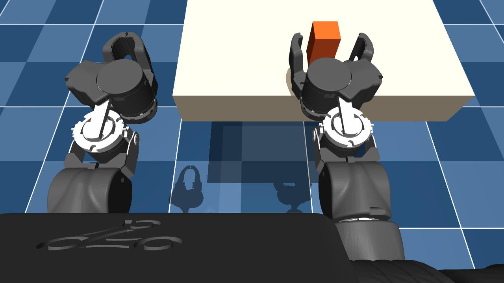
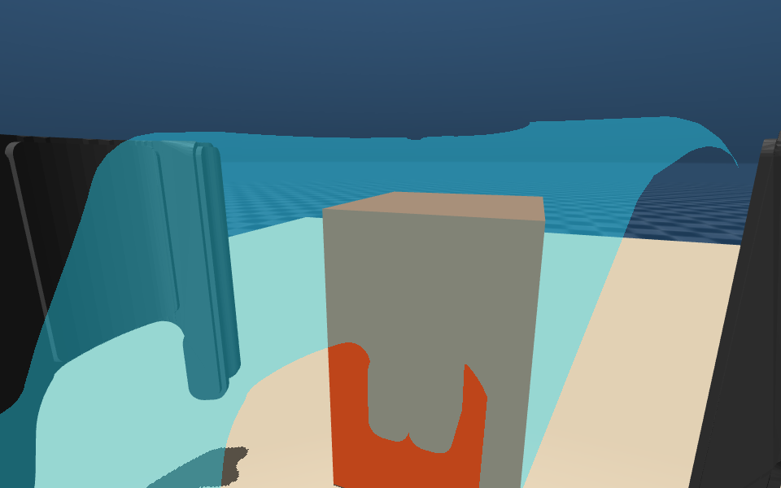

# OpenArm 把持判断ベンチマーク

2026年11月24日更新．MuJoCoでOpenArmの右ヘッド画像を生成し，同じ6姿勢を再評価した．保存済みのTerra highの18応答を集計に加えた．

## 結果の要点

- **ヘッド＋手首の2枚**と手首1枚では，いずれの経路でも正しい閉指件数が同じだった．Terra noneは両条件とも正しい閉指3/3，誤閉指2/3だった．
- **d3-lite**はヘッド＋手首の中央値499 msで最も速く，正例2/3を500 ms以内に検出した．負例3/3にも `close` を返した．
- **Luna Responsesの空閉じ重畳**は正しい閉指1/3，誤閉指0/3だった．前回は同じ画像で3/3，0/3だったため，6姿勢で一度得られた全問正答は再現しなかった．
- **Terra high**は3入力条件を合わせて10/18正答で，応答中央値は6,358 msだった．Terra noneは11/18正答，2,709 msだった．

## 比較条件

OpenArm v2 Pedestalの右腕を使い，40 × 40 × 64 mm，60 gの箱の配置を一つに固定した．モデルには，現在の手首姿勢のまま閉指して持ち上げれば箱を把持できるかを尋ねた．選択肢は全モデルで共通の `close`（閉指する），`wait`（待つ），`uncertain`（保留する）とした．MuJoCoの数値状態と正解ラベルは採点側だけが使った．

### 入力画像

| 入力条件 | モデルに渡す画像 | 何が見えるか |
| --- | --- | --- |
| 手首 | 右手首 `camera_wrist_right` 1枚（960 × 600） | 手元から見た指と箱 |
| ヘッド＋手首 | 右ヘッド `camera_head_right`（1280 × 720），右手首（960 × 600）の順に2枚 | ヘッドから見た作業台と，手元から見た指と箱 |
| 空閉じ重畳 | 右手首画像に完全閉指時の指をシアンで半透明に重ねた1枚（960 × 600） | 現在の指・箱に加え，空閉じした場合の指の投影位置 |

ヘッドは，使用した `openarm-mujoco` 2.3.0のCellモデルにある右カメラの定義を使った．それをCellの `arm_origin` からの相対位置・向きでPedestalに移し，縦画角52°と標準解像度を維持した．OpenArmのWebXRでも右ヘッドを単眼表示に用いる．高すぎる姿勢ではヘッド画像上で箱の大部分が手先に隠れた．空閉じ重畳は手首姿勢を固定し，指を0 radに置いたときの投影領域を不透明度40%で合成した．手首と重畳の全6枚，保存状態，正解ラベルは前回のものとバイト単位で一致した．[OpenArm Cellのカメラ定義](https://github.com/enactic/openarm_mujoco/blob/5a0b563edb77ef1103e65ed07137e94f6ef795ea/v2/cell/cell.xml#L73) · [OpenArm WebXRのヘッドカメラ](https://github.com/enactic/dora-openarm-webxr#head-camera)

同じ `near_reach` 姿勢の画像．「ヘッド＋手首」では，中央と左の画像をこの順で渡す．

| 手首 | 右ヘッド | 空閉じ重畳 |
| --- | --- | --- |
|  |  |  |

### モデルと出力形式

| 表のモデル名 | API・実行経路 | 出力形式 |
| --- | --- | --- |
| Luna Decisions | `gpt-6-luna` · OpenAI Decisions | APIのネイティブ三択 |
| d3-lite | `vllm-sr/d3-lite` · 公式System Oneランタイム，ローカルMPS | ランタイムのネイティブ三択 |
| Luna Responses | `gpt-6-luna` · OpenAI Responses，reasoning effort `none` | 共通JSON Schema |
| Terra none | `gpt-6.1-terra` · OpenAI Chat Completions，reasoning effort `none` | 共通JSON Schema |
| Terra high | `gpt-6.1-terra` · OpenAI Chat Completions，reasoning effort `high` | 共通JSON Schema |
| Qwen3-VL | Qwen3-VL-4B-Instruct 4-bit · ローカルvLLM-Metal／MLX | 共通JSON Schema |

生成型は `{"choice":"wait"}` のように `choice` 一つを許す共通スキーマを使った．Luna Responses，Terra none，Qwen3-VLの出力上限は32トークンとした．Terra highは同じ質問とスキーマを使い，`max_completion_tokens=8192`，タイムアウト90秒，`temperature` 省略で計測した．設定確認で `temperature=0` を送った最初のHTTP 400は設定ログに記録し，図の18応答は設定確定後のリクエストを対象とした．

選択型の2経路には同じ質問と選択肢をネイティブの形式で渡した．2枚入力の説明文は前回の外部カメラ試験と共通にした．d3-liteは `6c01fba`，BF16，バッチ1，Qwen3-VLは `2fd8dac` の重みを使った．

### 正解ラベル

各画像に対応する保存状態から腕の姿勢を保持して閉指し，40 mm持ち上げて0.40秒保持した．把持の成否は接触，支持面からの離脱，持ち上げ・保持の安定性から決めた．

| 把持試験 | 姿勢（基準からの手先オフセット X, Y, Z，mm） |
| --- | --- |
| 成功 3例 | 中央（0, 0, 0），手前の到達境界（−25, 0, 0），高めの到達境界（0, 0, +29） |
| 失敗 3例 | 届かない手前（−39, 0, 0），高すぎる（0, 0, +48），到達境界から横ずれ（−25, +16, 0） |

## 6姿勢での正答率と応答レイテンシ

6つのモデル・設定を3入力条件で比較した．各条件で同じ6姿勢を同じ提示順に1件ずつ送り，保存された108応答を集計した．各経路の入力条件の実行順は手首，空閉じ重畳，ヘッド＋手首とし，最初に得られた有効応答も含めた．

横軸は各応答のレイテンシ（秒，対数目盛），縦軸は同じモデル・入力条件での6姿勢に対する正答率．有効回答のうち，把持可能で `close`，把持不可で `wait` を返した件数を正答とした．`uncertain` と応答失敗は未判断として分母に含める．1点は1応答で，色がモデル，形が正しい閉指・誤閉指・待機・保留を表す．近い応答時間の点は重なる．

横の破線は固定 `wait` と固定 `close` の50%基準．正例・負例が各3件なので，どちらも片方のラベルだけ3/6正答になる．Luna Decisionsの全18応答は有効な `wait` で，正しい閉指は0件だった．d3-liteの手首とヘッド＋手首は全件 `close` で，それぞれ正しい閉指3/3，誤閉指3/3だった．正答率と併せて両方の閉指件数を読む．

縦の点線は500 ms．期限内の正しい閉指はd3-liteの手首3/3とヘッド＋手首2/3で，他のモデル・入力条件では0/3だった．例えば空閉じ重畳の中央姿勢で，d3-liteは227.2 ms，Luna Decisionsは739.0 ms，Luna Responsesは1,776.3 msで，いずれも `wait` を返した．Qwen3-VLの `uncertain` は手首5/6，ヘッド＋手首1/6，空閉じ重畳1/6だった．108件すべてで有効回答を得た．

レイテンシは，画像のリクエストへの詰め込みから回答の受信・検証までを計測した．HTTP経路では通信時間を含み，d3-liteは同一プロセスで実行した．モデルの起動，画像の描画，採点は計測区間の外にある．個々の判定，100・200・500 msの期限内閉指件数，p50とp95を判定データに収録した．

## 前回の検証と今回の解釈

18のモデル・入力条件のうち，正例3件すべてに閉指し，かつ誤閉指0件を得た条件はなかった．Terra highは手首4/6，ヘッド＋手首3/6，空閉じ重畳3/6正答で，正しい閉指9/9，誤閉指8/9だった．Terra noneとhighの比較は，出力上限と温度指定も含む実行設定全体の観測値として扱う．

前回の外部斜め視点＋手首では，Terra noneの正しい閉指は2/3，誤閉指は0/3だった．今回は同じ箱・姿勢でも，ヘッド＋手首で3/3，2/3だった．同じ重畳画像でもLuna ResponsesとTerra noneの判定が前回から変化している．カメラの差を評価するときは，同じ設定の繰り返しによる変動も考慮する必要がある．

初期の50配置・100例から配置単位で分けた80例（各ラベル40例）では，手首画像を使ったLuna Decisionsが全件 `wait`，当時のローカルQwen2.5-VL 3Bが全件 `close` を返した．それぞれウォームアップ後に計測した中央値は301 msと2,382 ms．前回の6姿勢では，生成型で1語回答とJSON Schemaも比較した．Qwen3-VLの正しい閉指は2/3から1/3，誤閉指は1/3から0/3，保留は2/6から5/6に変わった．同時にプロンプトの回答形式と出力上限を変更したため，これは設定全体の差として扱う．

前回「メイン画像」と記載したものは[外部斜め視点](external-oblique.png)だった．その結果は `*-dual`，今回のヘッド画像は `head-rerun-*-head-wrist` として判定データから読める．ヘッド条件の画像解像度も変わったため，この2回の差には視点，入力サイズ，計測回の影響が含まれる．

6姿勢の各入力・モデルは一回ずつの観測で，箱の種類と配置は固定している．物体・配置・実機への一般化や，撮像から指令反映までの実時間性能は追加の検証が必要になる．

[判定データ・画像ハッシュ・実行条件](results.json) · [評価コードと再現コマンド](../README.md)

## ローカル再現確認

6姿勢を再生成し，把持成功3件・失敗3件と全6状態の再実行を確認した．同じ状態から右ヘッド画像と手首重畳を生成し，`always-wait` で6件の待機，正しい閉指0/3，誤閉指0/3を確認した．全pytestは145件通過，Doraの実プロセス起動などのオプトインテストは4件スキップだった．Ruffのlint・formatチェックは通過した．tyではMuJoCoが実行時に公開する属性の型解決に113件の診断が残った．
