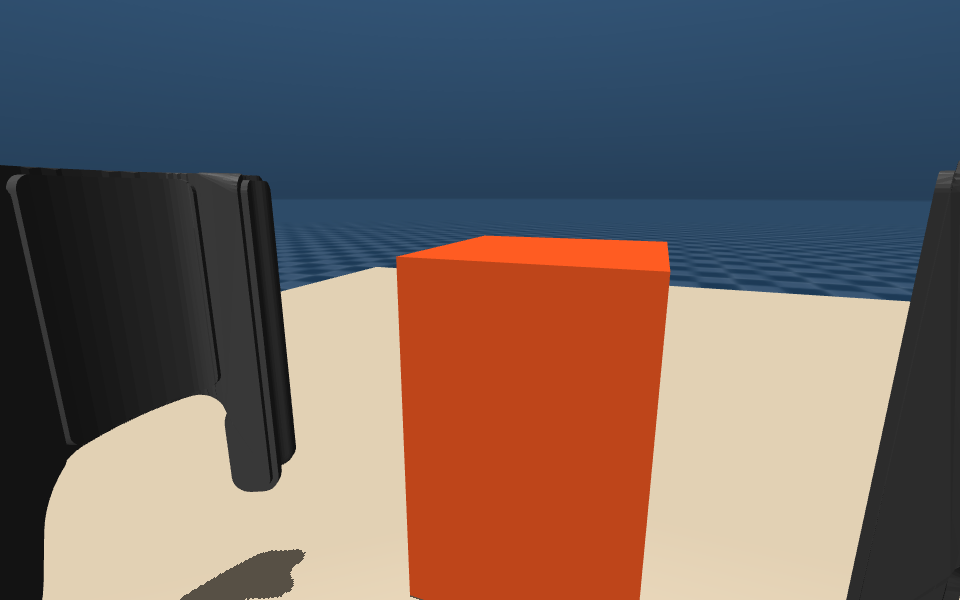
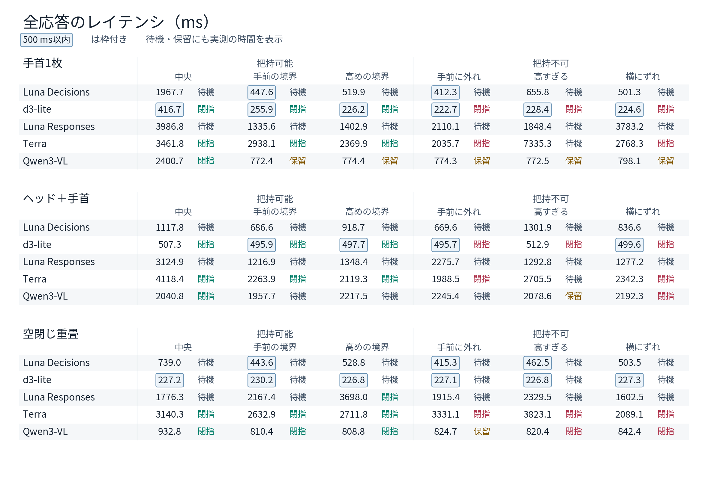

# OpenArm 把持判断ベンチマーク

2026年11月24日更新．MuJoCoでOpenArmの右ヘッド画像を生成し，同じ6姿勢を再評価した．

## 結果の要点

- **ヘッド＋手首の2枚**では，手首1枚より正しい閉指が増えた経路はなかった．Terraは両条件とも正しい閉指3/3，誤閉指2/3だった．
- **d3-lite**はヘッド＋手首の中央値499 msで最も速く，正例2/3を500 ms以内に検出した．負例3/3にも `close` を返した．
- **Luna Responsesの空閉じ重畳**は正しい閉指1/3，誤閉指0/3だった．前回は同じ画像で3/3，0/3だったため，6姿勢で一度得られた全問正答は再現しなかった．

## 比較条件

OpenArm v2 Pedestalの右腕を使い，40 × 40 × 64 mm，60 gの箱の配置を一つに固定した．モデルには，現在の手首姿勢のまま閉指して持ち上げれば箱を把持できるかを尋ねた．選択肢は全モデルで共通の `close`（閉指する），`wait`（待つ），`uncertain`（保留する）とした．MuJoCoの数値状態と正解ラベルは採点側だけが使った．

### 入力画像

| 入力条件 | モデルに渡す画像 | 何が見えるか |
| --- | --- | --- |
| 手首 | 右手首 `camera_wrist_right` 1枚（960 × 600） | 手元から見た指と箱 |
| ヘッド＋手首 | 右ヘッド `camera_head_right`（1280 × 720），右手首（960 × 600）の順に2枚 | ヘッドから見た作業台と，手元から見た指と箱 |
| 空閉じ重畳 | 右手首画像に完全閉指時の指をシアンで半透明に重ねた1枚（960 × 600） | 現在の指・箱に加え，空閉じした場合の指の投影位置 |

ヘッドは，使用した `openarm-mujoco` 2.3.0のCellモデルにある右カメラの定義を使った．それをCellの `arm_origin` からの相対位置・向きでPedestalに移し，縦画角52°と標準解像度を維持した．OpenArmのWebXRでも右ヘッドを単眼表示に用いる．高すぎる姿勢ではヘッド画像上で箱の大部分が手先に隠れた．空閉じ重畳は手首姿勢を固定し，指を0 radに置いたときの投影領域を不透明度40%で合成した．手首と重畳の全6枚，保存状態，正解ラベルは前回のものとバイト単位で一致した．[OpenArm Cellのカメラ定義](https://github.com/enactic/openarm_mujoco/blob/5a0b563edb77ef1103e65ed07137e94f6ef795ea/v2/cell/cell.xml#L73) · [OpenArm WebXRのヘッドカメラ](https://github.com/enactic/dora-openarm-webxr#head-camera)

同じ `near_reach` 姿勢の画像．「ヘッド＋手首」では，中央と左の画像をこの順で渡す．

| 手首 | 右ヘッド | 空閉じ重畳 |
| --- | --- | --- |
|  |  |  |

### モデルと出力形式

| 表のモデル名 | API・実行経路 | 出力形式 |
| --- | --- | --- |
| Luna Decisions | `gpt-6-luna` · OpenAI Decisions | APIのネイティブ三択 |
| d3-lite | `vllm-sr/d3-lite` · 公式System Oneランタイム，ローカルMPS | ランタイムのネイティブ三択 |
| Luna Responses | `gpt-6-luna` · OpenAI Responses，reasoning effort `none` | 共通JSON Schema |
| Terra | `gpt-6.1-terra` · OpenAI Chat Completions，reasoning effort `none` | 共通JSON Schema |
| Qwen3-VL | Qwen3-VL-4B-Instruct 4-bit · ローカルvLLM-Metal／MLX | 共通JSON Schema |

生成型の3経路では `{"choice":"wait"}` のように `choice` 一つだけを許す同じスキーマを使い，出力上限を32トークンに揃えた．選択型の2経路には同じ質問と選択肢をネイティブの形式で渡した．2枚を渡す際の説明文は，前回の外部カメラ試験と共通にした．d3-liteは `6c01fba`，BF16，バッチ1，Qwen3-VLは `2fd8dac` の重みを使用した．

### 正解ラベル

各画像に対応する保存状態から腕の姿勢を保持して閉指し，40 mm持ち上げて0.40秒保持した．把持の成否は接触，支持面からの離脱，持ち上げ・保持の安定性から決めた．

| 把持試験 | 姿勢（基準からの手先オフセット X, Y, Z，mm） |
| --- | --- |
| 成功 3例 | 中央（0, 0, 0），手前の到達境界（−25, 0, 0），高めの到達境界（0, 0, +29） |
| 失敗 3例 | 届かない手前（−39, 0, 0），高すぎる（0, 0, +48），到達境界から横ずれ（−25, +16, 0） |

## 6姿勢での再評価結果

5経路 × 3入力条件を各6件，条件内では同じ提示順で1件ずつ送った．各経路で手首，空閉じ重畳，ヘッド＋手首の順に実行した．初回応答を含めて集計した．

### 全応答のレイテンシ

同じ姿勢を列で揃え，「応答時間（ms）・判定」を併記した．`close`（閉指），`wait`（待機），`uncertain`（保留）の全90応答を収録した．枠付きの値は500 ms以内．

例えば空閉じ重畳の中央姿勢では，**d3-liteは227.2 ms，Luna Decisionsは739.0 ms，Luna Responsesは1,776.3 ms**で，いずれも `wait` を返した．待機や保留の応答時間も計測し，閉指の件数には有効な `close` を数える．

### 正しい閉指

把持できた3姿勢のうち，`close` を返した件数．

| モデル | 手首 | ヘッド＋手首 | 空閉じ重畳 |
| --- | ---: | ---: | ---: |
| Luna Decisions | 0/3 | 0/3 | 0/3 |
| d3-lite | 3/3 | 3/3 | 0/3 |
| Luna Responses | 0/3 | 0/3 | 1/3 |
| Terra | 3/3 | 3/3 | 3/3 |
| Qwen3-VL | 1/3 | 1/3 | 3/3 |

### 誤閉指

把持できなかった3姿勢のうち，`close` を返した件数．

| モデル | 手首 | ヘッド＋手首 | 空閉じ重畳 |
| --- | ---: | ---: | ---: |
| Luna Decisions | 0/3 | 0/3 | 0/3 |
| d3-lite | 3/3 | 3/3 | 0/3 |
| Luna Responses | 0/3 | 0/3 | 0/3 |
| Terra | 2/3 | 2/3 | 3/3 |
| Qwen3-VL | 0/3 | 1/3 | 2/3 |

90件すべてで有効回答を得た．`uncertain` を返したのはQwen3-VLのみで，手首5/6，ヘッド＋手首1/6，空閉じ重畳1/6だった．

### 応答レイテンシ

各欄は **中央値 p50（p95）**，単位はms．有効回答を対象に，画像のリクエストへの詰め込みから回答の受信・検証までを計測した．HTTP経路では通信を含む．d3-liteは同一プロセスで実行した．モデルの起動，画像の描画，採点は計測区間の外にある．p95は6件の線形補間値．

| モデル | 手首 | ヘッド＋手首 | 空閉じ重畳 |
| --- | ---: | ---: | ---: |
| Luna Decisions | 511（1,640） | 878（1,256） | 483（686） |
| d3-lite | 227（376） | 499（512） | 227（229） |
| Luna Responses | 1,979（3,936） | 1,321（2,913） | 2,041（3,356） |
| Terra | 2,853（6,367） | 2,303（3,765） | 2,926（3,700） |
| Qwen3-VL | 774（2,000） | 2,135（2,238） | 823（910） |

**500 ms以内の正しい閉指**はd3-liteの手首3/3とヘッド＋手首2/3だった．ほかの経路・入力条件では0/3だった．100 ms・200 msの結果も判定データに収録した．

## 前回の検証と今回の解釈

ヘッド＋手首で，Terraの閉指件数は手首1枚と同じで，Qwen3-VLの誤閉指は0件から1件に増えた．Luna Decisionsは18件すべてで `wait` を返し，Luna Responsesも重畳以外の12件で `wait` を返した．d3-liteは手首とヘッド＋手首の両方で全件 `close` だった．今回の15条件のうち，正例3件すべてに閉指し，かつ誤閉指を0件に抑えた条件はなかった．

前回の外部斜め視点＋手首では，Terraの正しい閉指は2/3，誤閉指は0/3だった．今回は同じ箱・姿勢でも，ヘッド＋手首で3/3，2/3だった．同じ重畳画像でもLuna ResponsesとTerraの判定が前回から変化している．カメラの差を評価するときは，同じ設定の繰り返しによる変動も考慮する必要がある．

初期の50配置・100例から配置単位で分けた80例（各ラベル40例）では，手首画像を使ったLuna Decisionsが全件 `wait`，当時のローカルQwen2.5-VL 3Bが全件 `close` を返した．それぞれウォームアップ後に計測した中央値は301 msと2,382 ms．前回の6姿勢では，生成型で1語回答とJSON Schemaも比較した．Qwen3-VLの正しい閉指は2/3から1/3，誤閉指は1/3から0/3，保留は2/6から5/6に変わった．同時にプロンプトの回答形式と出力上限を変更したため，これは設定全体の差として扱う．

前回「メイン画像」と記載したものは[外部斜め視点](external-oblique.png)だった．その結果は `*-dual`，今回のヘッド画像は `head-rerun-*-head-wrist` として判定データから読める．ヘッド条件の画像解像度も変わったため，この2回の差には視点，入力サイズ，計測回の影響が含まれる．

6姿勢の各入力・モデルは一回ずつの観測で，箱の種類と配置は固定している．物体・配置・実機への一般化や，撮像から指令反映までの実時間性能は追加の検証が必要になる．

[判定データ・画像ハッシュ・実行条件](results.json) · [評価コードと再現コマンド](../README.md)

描画コードは `49b6c87`．Grip関連pytestは27件通過し，変更したPythonファイルのRuffも通過した．
